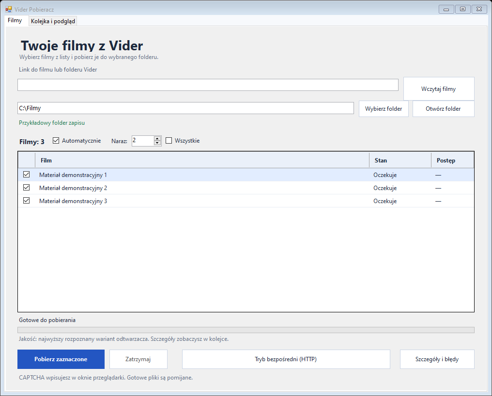

# Vider Pobieracz

Darmowe pobieranie materiałów wideo z Videra — bezpłatna aplikacja dla Windows.
Polski interfejs, kolejka w osobnej zakładce, równoległe pobieranie
i ręczne wpisywanie CAPTCHA.

**Program jest całkowicie darmowy i udostępniony na licencji MIT.**

## Pobierz gotowy program

**[Pobierz gotowy program dla Windows x64](https://github.com/TLLogika/vider-pobieranie/releases/latest/download/Vider-Pobieracz-Windows-x64.zip)**

Rozpakuj ZIP i uruchom `ViderDownloader.exe`. Pozostaw dołączone biblioteki obok EXE.
Nie trzeba kompilować kodu ani instalować Visual Studio.
Program jest przenośny. Wymaga .NET Framework 4.8 i Edge WebView2 Runtime.
[Wszystkie wydania i informacje o zmianach](https://github.com/TLLogika/vider-pobieranie/releases).

## Co potrafi

- Wczytuje link do filmu lub folderu Vider.
- Pokazuje listę materiałów i pozwala wybrać pliki do pobrania.
- Pozwala wpisać liczbę pobrań jednocześnie albo zaznaczyć **Wszystkie**.
- Automatycznie przygotowuje odtwarzacz i rozpoczyna zapis; CAPTCHA wpisujesz ręcznie.
- Wybiera najwyższy rozpoznany wariant jakości udostępniany przez odtwarzacz.
- Pokazuje postęp, prędkość i podsumowanie w zakładce **Kolejka i podgląd**.
- Działa po zmianie zakładki i zminimalizowaniu okna.
- Zachowuje pliki częściowe do wznowienia i pomija istniejące pliki.

## Jak działa

Program otwiera stronę filmu we własnej przeglądarce WebView2. Po ręcznym
przejściu ewentualnej CAPTCHA i uruchomieniu odtwarzacza rozpoznaje adres
MP4 oraz kontekst działającej sesji. Zapis odbywa się przez HTTP z potrzebnymi
nagłówkami i ciasteczkami; istnieje także zapasowa ścieżka zapisu WebView2.
Film trafia najpierw do `.mp4.part`, a po poprawnym zakończeniu do `.mp4`.

Więcej o kodzie: [architektura](docs/ARCHITEKTURA.md).

## Budowanie ze źródeł

- Windows x64, .NET Framework 4.8 i Microsoft Edge WebView2 Runtime.
- Internet przy pierwszym przygotowaniu bibliotek.

1. Pobierz lub sklonuj repozytorium i otwórz jego folder.
2. Uruchom `build.cmd`. Przy pierwszym budowaniu skrypt pobierze WebView2
   SDK **1.0.4314.35** z oficjalnego NuGet i przygotuje lokalne biblioteki.
3. Uruchom `ViderDownloader.exe`, wybierz folder zapisu i wklej swój link.
4. Kliknij **Wczytaj filmy**, zaznacz materiały i **Pobierz zaznaczone**.
5. Jeśli pojawi się CAPTCHA, wpisz kod w zakładce danego filmu.

W VS Code **Ctrl+Shift+B** buduje program. Plik `.csproj` jest dostępny
dla narzędzi MSBuild z zestawem referencyjnym .NET Framework 4.8.
Przed przebudowaniem uruchomionego EXE zakończ jego pobierania i zamknij go.

## Jakość i ograniczenia

Program zapisuje dostępny strumień bez ponownego kodowania. Jakość zależy
od wybranego uploadu. Rozpoznaje warianty JW Player i opisane źródła HTML video;
nie wyszukuje innych uploadów i nie rozpoznaje języka dźwięku.
HLS/DASH i DRM nie są obsługiwane. Zmiany witryny mogą wymagać aktualizacji parsera.
Wybór jakości dotyczy głównego trybu przeglądarki; dodatkowy tryb HTTP
pozostaje starszą funkcją diagnostyczną.

## Dane lokalne

Lista po uruchomieniu jest pusta. Repozytorium zawiera tylko ogólny plik
`ustawienia.przyklad.xml`; rzeczywiste ustawienia i dziennik powstają lokalnie.
Profil przeglądarki jest przechowywany w katalogu aplikacji użytkownika.
Te pliki oraz filmy, dane sesji i wyniki budowania są wykluczone w `.gitignore`.
Przed udostępnieniem własnych logów usuń z nich dane lokalne i identyfikatory.
Zrzut powyżej przedstawia interfejs z fikcyjnymi danymi demonstracyjnymi.

Korzystaj z programu do materiałów, do których masz odpowiednie uprawnienia.
Projekt nie zawiera filmów ani list linków do konkretnych nagrań.

## Licencja i biblioteki

Kod aplikacji: [MIT](LICENSE). WebView2 jest biblioteką Microsoft dostarczaną
na własnych warunkach: [informacje o zależnościach](THIRD_PARTY_NOTICES.md).
Inspiracja funkcjonalna: [kosciolek/vider.info-downloader](https://github.com/kosciolek/vider.info-downloader).
To osobna implementacja C# WinForms.
